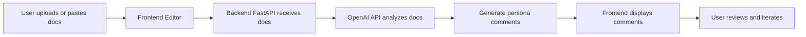

# Empathometer - An AI Technical Documentation Analyzer

**A multi-persona AI-powered documentation analyzer built with FastAPI and OpenAI.**  

This tool reads your technical documentation and provides feedback from multiple perspectives: Junior Developers, Senior Developers, Business Users, and an AI agent. It helps you identify gaps, confusing sections, and actionable suggestions, so your documentation is clearer and more effective.


## Table of Contents
- [What It Does](#what-it-does)  
- [Key Features](#key-features)  
- [Tech Stack](#tech-stack)  
- [Getting Started](#getting-started)  
  - [Clone the Repository](#clone-the-repository)  
  - [Set Up the Environment](#set-up-the-environment)  
  - [Install Dependencies](#install-dependencies)  
  - [Add API Keys](#add-api-keys)  
  - [Run the App](#run-the-app)  
- [How to Use](#how-to-use)  
- [Personas Explained](#personas-explained)  
- [Sample Persona Comments](#sample-persona-comments)  
- [Workflow Diagram](#workflow-diagram)  
- [Folder Structure](#folder-structure)  
- [Contributing](#contributing)  
- [License](#license)  

## What It Does
AI Docs Analyzer reads your documentation and generates **persona-driven comments**:

- **Junior Developer**: Asks clarifying questions, identifies missing context, and points out areas that might confuse a beginner.  
- **Senior Developer**: Focuses on brevity, accuracy, and technical correctness.  
- **Business User**: Highlights the business relevance, metrics, and clarity for non-technical audiences.  
- **AI Agent**: Suggests tasks, queries, or improvements that can be performed based on the content.

With this, you can quickly see where your docs are strong and where they need improvement.

## Key Features
- Multi-persona feedback on documentation  
- Real-time inline comments  
- Actionable insights from AI  
- Supports both short and long documentation  
- Easy to run locally with minimal setup  

## Tech Stack
- **Backend:** Python, FastAPI  
- **Frontend:** HTML, CSS, JavaScript  
- **AI:** OpenAI API  
- **Other:** Git for version control, `.gitignore` for secret management  

## Getting Started
Follow these steps to set up and run the project on your local machine.

### Clone the Repository
```bash
git clone https://github.com/Kemi-Elizabeth/AI-DocReviewer.git
cd AI-DocReviewer
```

### Set Up the Environment
Create a virtual environment (to keep dependencies isolated):
```bash
python3 -m venv venv
source venv/bin/activate   # Mac/Linux
venv\Scripts\activate      # Windows
```

### Install Dependencies
```bash
pip install -r backend/requirements.txt
```
This installs FastAPI, OpenAI, and all other required libraries.

### Add API Keys
Create a `.env` file in the `backend/` folder with your OpenAI API key:

```bash
OPENAI_API_KEY=your_openai_api_key_here
```
**Note:** `.env` is included in `.gitignore` for security.

### Run the App

#### Start the backend server:

```bash
cd backend
uvicorn main:app --reload
```
#### Open the frontend in your browser:

```bash
open ../frontend/index.html   # Mac
# or just double-click the HTML file on any OS
```
You’re now ready to interact with your AI Docs Analyzer.

## How To Use

1. Paste or load your documentation into the editor on the frontend.
2. Click “Analyze” to generate comments.
3. Review feedback from all four personas
4. Each persona’s comments appear in separate sections.
5. Iterate on your documentation based on the feedback.

## Personas Explained

| Persona          | Focus                 | Example Feedback                                                                                       |
|-----------------|----------------------|--------------------------------------------------------------------------------------------------------|
| Junior Developer | Clarity & basics     | “Wait… what does PHP-FPM stand for?”                                                                  |
| Senior Developer | Brevity & correctness| “This section is too long; summarize in 3 lines.”                                                     |
| Business User    | Metrics & impact     | “How does this affect our conversion rate or KPIs?”                                                   |
| AI Agent         | Actions & tasks      | “Based on this content, I could answer these queries: [X, Y, Z] or suggest improvements in structure.”|

## Sample Persona Comments

**Documentation excerpt:**
“To deploy the application, first ensure Docker is installed and then configure the environment variables before starting the containers.”

**Junior Dev:**
“What does Docker mean here? Is it needed on all machines?”
“Which environment variables exactly? Can you give examples?”
“What does ‘starting the containers’ involve? I’m confused.”

**Senior Dev:**
“Too verbose. Condense to: Install Docker, set environment vars, run containers.”
“Check command syntax; consider adding default values.”

**Business User:**
“Does this deployment process affect uptime or SLA?”
“Are there costs associated with Docker for this setup?”

**AI Agent:**
“Could provide step-by-step instructions for setup.”
“Could generate a checklist for deployment.
“Could validate environment variables automatically.”

## Workflow Diagram


The diagram shows how documentation flows from input to AI analysis, persona comment generation, and back to the user.

## Folder Structure

```bash
AI-DocReviewer/
│
├─ backend/
│   ├─ main.py          # FastAPI backend
│   ├─ requirements.txt # Python dependencies
│   ├─ __pycache__/     # Python cache files
│   └─ .env             # API keys (ignored)
│
├─ frontend/
│   ├─ index.html       # User interface
│   ├─ styles.css       # Styling
│   └─ script.js        # JS logic
│
├─ .gitignore
└─ README.md
```

## Contributing

1. Fork the repository
2. Create a feature branch:

```bash
git checkout -b feature/new-persona
```
3. Commit your changes:

```bash
git commit -m "Add new persona"
```

4. Push to branch:
```bash
git push origin feature/new-persona
```

5. Open a Pull Request

## License

**MIT License © Kemi Elizabeth Ojogbede**